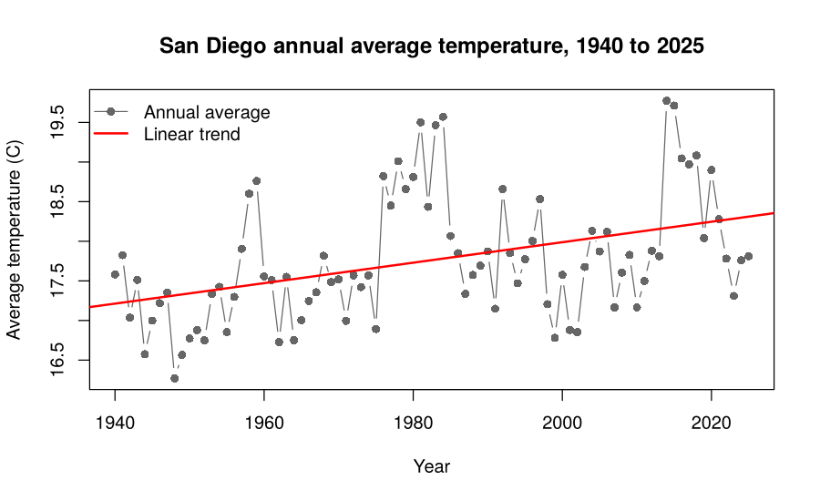

# San Diego Climate Stats

Practice project in R using 86 years of daily weather data from San Diego (1940 to 2025). I wanted to practice cleaning real data, fitting simple statistical models, and being careful about what the results do and do not show.

This is a small learning project, not a climate study. It uses one weather station and simple models.

## Data

NOAA GHCN-Daily, station USW00023188 (San Diego International Airport). Daily high temperature, low temperature, and rainfall, downloaded from the NOAA NCEI Data Service:

https://www.ncei.noaa.gov/access/services/data/v1?dataset=daily-summaries&stations=USW00023188&startDate=1940-01-01&endDate=2025-12-31&dataTypes=TMAX,TMIN,PRCP&units=metric&format=csv&includeStationName=true&includeStationLocation=1

Temperatures are in degrees C and rainfall is in mm. The file is saved in `data/san_diego_daily.csv`.

## Scripts

Run them from the project folder, in any order after the first one is in place.

- `00_load_and_clean.R` loads the data and checks it: date range, missing days, missing values. It also builds a daily average temperature (the midpoint of the daily high and low). The other scripts call this one.
- `01_san_diego_temperature.R` looks at annual average temperature, fits a linear trend, compares 1940 to 1969 with 1996 to 2025, and fits summer and winter trends separately.
- `02_san_diego_rainfall.R` looks at rainfall by rain year (July to June), how much it varies, and whether there is a trend.
- `03_matrix_least_squares.R` redoes the temperature trend with matrices (the normal equations and QR decomposition), checks it against `lm()`, and shows why centering the year matters.

Only base R is needed. Plots are saved to the `figures` folder.

## What I found

- Data quality was good. Only 3 calendar days have no row (April 6 to 8, 1947) and 5 temperature values are missing, so every year has at least 362 valid days.
- Annual average temperature went up about 0.13 C per decade (95% confidence interval 0.07 to 0.19), roughly 1.1 C over the 86 years. The 1996 to 2025 average was 0.68 C higher than the 1940 to 1969 average.
- Summer and winter warmed at similar rates, about 0.12 and 0.11 C per decade.
- The warmest years were 2014 and 2015. The coolest was 1948.
- Rainfall averages about 251 mm (9.9 inches) per rain year but swings a lot. The wettest rain year was 1941 (24.8 inches) and the driest was 2002 (3.0 inches). There is no clear trend (about -3 mm per decade, p = 0.56).

## Limits of this analysis

- The temperature residuals are correlated from one year to the next (lag 1 autocorrelation about 0.58). The warming shows up in stretches, like the late 1970s to 1980s and 2014 to 2018, not as a steady climb. A plain linear regression assumes independent errors, so its p-value and confidence interval are probably too optimistic.
- It is one station at an airport near the bay. Its surroundings changed over 86 years, and one station does not represent all of San Diego County.
- The daily average is just the midpoint of the high and low, which is an estimate of the true daily mean.
- Linear trends only. I did not account for things like El Nino years.

## Next steps

- Redo the trend with a method that allows for year-to-year correlation in the errors
- Compare warm stretches with El Nino years
- Add an inland station and compare it with the airport
- Redo the matrix script in Python
